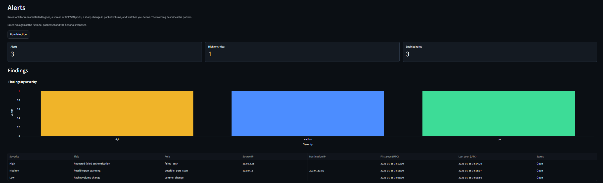
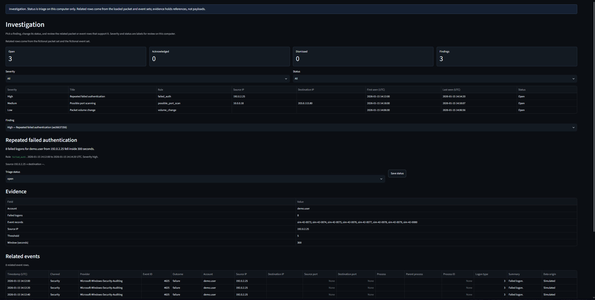
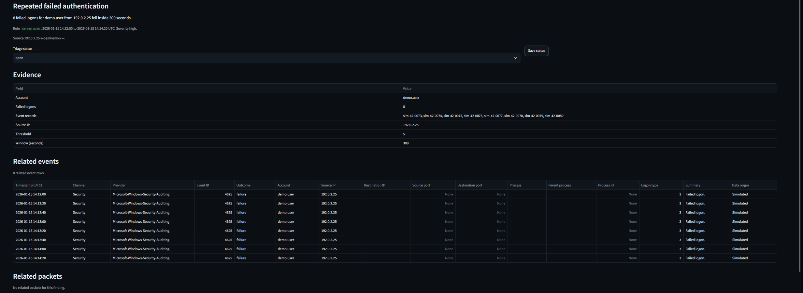

# NetWatch

NetWatch is a Python-based network security monitoring project designed to analyze packet metadata and Windows security events through a local Streamlit dashboard. It combines simulated security telemetry, offline packet capture analysis, and SQLite persistence to support structured exploration of network and system activity.

Built to demonstrate a local security monitoring workflow—packets plus Windows events—using Streamlit and related tooling without live capture or a lab network, and to show disciplined scoping from simulation through offline analysis, persistence, detection, and investigation.

## Stack

- **Language / runtime:** Python 3.12 on Windows 10 or later
- **UI:** Streamlit (dark theme, loopback bind) and Plotly charts
- **Data:** pandas; SQLite for the active packet and event sets
- **Packets:** Scapy for offline PCAP / PCAPNG metadata
- **Windows logs:** PowerShell and read-only `wevtutil` queries
- **Tests:** pytest

## Current status

Implemented now:

- **Phase 1 — Simulated traffic dashboard.** Seeded fictional packet metadata (800 rows, fixed 30-minute UTC window, including a TCP SYN burst and a one-minute volume increase); Overview metrics and packets-over-time; protocol, top address, and port charts; filters for IP, protocol, port, and time; metadata table with a data-origin label
- **Phase 2 — Offline PCAP analysis.** PCAP / PCAPNG / CAP upload parsed with Scapy into that same table; 50 MB upload cap and 100,000 packet cap
- **Phase 3 — Windows events and SQLite.** Seeded fictional security events (80 rows, same window, including eight failed logons); Security Events page with filters and an events-over-time chart; optional local read of Security, System, Application, and Sysmon (missing channels and access denials reported and skipped); SQLite persistence for the active packet and event sets (`data/netwatch.db`); unit tests for the generator, record contracts, filters, capture parser, event reader, and database
- **Phase 4 — Detection rules and alerts.** Failed authentication, possible port scanning, volume change, and user-defined watch rules. Failed authentication and possible port scanning name a MITRE ATT&CK technique as review context. Findings are stored in the local database and shown on the Alerts page. The wording describes the pattern
- **Phase 5 — Investigation and portfolio polish.** Alert triage (`open` / `acknowledged` / `dismissed`) on the Investigation page; related packet and event rows rebuilt from evidence references; example investigation walkthrough; architecture notes

## Screenshots

Views from Phases 1–5 on the seeded fictional packet and event sets. Save PNGs under [`docs/screenshots/`](docs/screenshots/) using the filenames below.









| File | Subject |
| --- | --- |
| `overview.png` | Overview metrics and packets-over-time |
| `network-traffic.png` | Network Traffic filters and table |
| `security-events.png` | Security Events, including failed logons for `demo.user` from `192.0.2.25` |
| `alerts.png` | Alerts for the seeded failed logons, SYN burst, and volume increase |
| `investigation.png` | Investigation filters, status control, and related rows |
| `investigation-failed-auth.png` | Failed-authentication finding with related event rows |
| `sidebar-pcap.png` | Sidebar offline capture upload (optional) |

## Limitations

NetWatch is a portfolio and learning project, not a production IDS. Scope stays on this machine and on metadata already in hand.

- No live packet capture; offline PCAP / PCAPNG upload only
- No payload bytes, command lines, free-text log messages, passwords, or threat-intelligence lookups
- No telemetry; data is not sent off the machine
- Dashboard binds to `127.0.0.1` only; do not expose it to the internet
- One active packet set and one active event set at a time
- Detection findings describe patterns in the stored metadata. Severity is a review label
- Upload capped at 50 MB; at most 100,000 acceptable packets kept
- Local Windows log read needs appropriate rights; missing channels (for example Sysmon) are skipped

## Simulated data

Every packet in the demonstration set is generated in memory with a fixed random seed. Addresses come from [RFC 5737](https://www.rfc-editor.org/rfc/rfc5737) documentation ranges and [RFC 1918](https://www.rfc-editor.org/rfc/rfc1918) private ranges. While that set is loaded, the dashboard banner states that the rows are fictional.

The full set reserves two patterns for the detection rules: a TCP SYN burst from `10.0.0.18` to `203.0.113.80` on ports 2000–2019, and 80 packets in one minute from `192.168.1.10` to `192.0.2.10`. Smaller generated fixtures omit those bursts.

## Offline captures

The sidebar accepts one `.pcap`, `.pcapng`, or `.cap` file. Parsing happens in memory. The capture is not written into the repository.

Scapy keeps timestamp, addresses, protocol, ports, length, IP version, and TCP flags. Packets without usable IP metadata are counted and skipped. Reading a saved file does not require Npcap.

The table column "Data origin" reads "Imported" for these rows. "Use simulated data" loads the fictional set again. Imported metadata is saved in the local database and shown again on the next launch.

## Windows events

Security Events opens on a seeded fictional log. The accounts are `demo.user`, `svc.backup`, and `lab.admin`. Addresses stay inside the same documentation and private ranges as the packets. Eight rows are failed logons for `demo.user` from `192.0.2.25`. While that set is loaded, the banner says the rows are fictional.

"Read local Windows logs" queries four channels with `wevtutil`: Security, System, Application, and Sysmon (`Microsoft-Windows-Sysmon/Operational`). The query is read-only; NetWatch does not clear logs. Refused or missing channels are reported and skipped. A read that keeps nothing leaves the current event set in place. The Security channel often refuses readers that are not elevated. Sysmon is absent unless it is installed.

For events it keeps, NetWatch stores time, channel, provider, event id, account, addresses, ports, the process file name, the parent file name, process id, logon type, and a fixed summary sentence such as "Failed logon." "Use simulated events" loads the fictional set again.

## Local database

The active packet set and the active event set are stored in `data/netwatch.db`. That file is gitignored. Restarting the dashboard loads it. An upload, a local log read, or a return to simulated data replaces the rows it owns.

Tests set `NETWATCH_DB` to a temporary file so they do not use the dashboard database.

## Detection

Alerts run on the packet set and the event set that are loaded. Three rules are installed with the database:

- **Repeated failed authentication.** Failed logons (Windows event 4625) for the same account and source address inside a time window. The default is 5 failures in 300 seconds. The fictional event set includes eight failed logons for `demo.user` from `192.0.2.25`.
- **Possible port scanning.** TCP SYN packets from one source to many destination ports on one host. The default is 15 distinct ports in 60 seconds. The fictional packet set includes the SYN burst described above.
- **Packet volume change.** A time bucket whose packet count is at least 3 times the median of the other buckets, and at least 40 packets. The fictional packet set includes the one-minute increase described above.

Two of those rules name a MITRE ATT&CK technique as review context for the pattern. The id is not stored on the finding, and it is not a coverage claim.

- **Repeated failed authentication** is consistent with [T1110.001 Password Guessing](https://attack.mitre.org/techniques/T1110/001/) (Credential Access).
- **Possible port scanning** is consistent with [T1046 Network Service Discovery](https://attack.mitre.org/techniques/T1046/) (Discovery).
- **Packet volume change** has no technique. A larger time bucket is not one ATT&CK technique.

Each built-in rule can be turned off, and its numbers can be changed, from the Alerts page. A watch matches packets or events on the fields you set: address, protocol, port, account, event id, and outcome. One watch produces one finding for the rows that match every field. Watches are unmapped.

The finding text states the counts, the window, and the addresses involved. Findings are replaced when the packet set, the event set, or the rules change. A finding that appears again keeps the status and the time it was first stored.

## Investigation

The Investigation page filters findings by severity and status, sets triage status (`open`, `acknowledged`, or `dismissed`), and shows the evidence fields plus related packet or event rows from the sets that are loaded. Related rows are rebuilt from references in the finding (event uids, addresses, ports, time windows, watch criteria). Status changes are saved in the local database without re-running detection; a later re-detect still keeps that status when the same finding appears again.

### Example investigations

On the seeded fictional sets:

1. **Repeated failed authentication.** Open Investigation, select the high-severity failed-authentication finding. The page names T1110.001 Password Guessing as context. Evidence lists eight event records for `demo.user` from `192.0.2.25`. Related events show the matching 4625 rows. Set status to `acknowledged` when you have reviewed them.
2. **Possible port scanning.** Select the medium-severity SYN finding. The page names T1046 Network Service Discovery as context. Related packets show TCP SYN rows from `10.0.0.18` to `203.0.113.80` across ports 2000–2019.
3. **Packet volume change.** Select the low-severity volume finding. It has no technique id. Related packets are the rows inside the elevated one-minute bucket.

Severity remains a review label. The page does not call a finding an intrusion.

## Requirements

- Windows 10 or later
- Python 3.12
- PowerShell

On this machine, `python` is the Microsoft Store alias and does not run Python 3.12. Use `py -3.12` to create the virtual environment, then the environment's `python.exe`.

## Setup

Run these commands in PowerShell from the repository root:

```powershell
py -3.12 -m venv .venv
.\.venv\Scripts\python.exe -m pip install -r requirements.txt
```

If activation is blocked by execution policy, you do not need to change that policy. Call `.\.venv\Scripts\python.exe` directly, as the commands above do.

## Run

PowerShell, from the repository root:

```powershell
.\.venv\Scripts\python.exe -m streamlit run app.py --server.address 127.0.0.1 --server.port 8501
```

Open http://127.0.0.1:8501 in a browser on this computer.

## Test

PowerShell, from the repository root:

```powershell
.\.venv\Scripts\python.exe -m pytest
```

Generator, filter, parser, event, detection, investigation, and database tests call those functions directly. They build small captures in memory and do not send packets. They do not query this computer's Windows logs; the reader tests pass in XML and canned status text. Detection tests cover the seeded failed-logon burst, the SYN burst, the volume increase, and watches. Investigation tests rebuild related rows for those findings and confirm a saved status survives re-detect. Dashboard tests set `NETWATCH_DB` to a temporary file. One test runs the dashboard through Streamlit's app runner to confirm an upload replaces the fictional packet set and a file that is not a capture leaves that set in place. Another confirms Security Events can switch to a canned local read and back to the fictional log. Others open Alerts and Investigation and check the seeded findings, including saving an acknowledged status.

In the dashboard, Overview shows the full seeded set. On Network Traffic:

- IP `192.0.2.10` narrows the table to packets involving that documentation address.
- IP `192.0.2.199` is valid and outside the seeded set, so the table is empty.
- Protocol, port, and the UTC time slider narrow the same table.

On Security Events, the fictional set includes failed logons for `192.0.2.25`. Outcome, channel, event id, account, IP, and the UTC time slider narrow that table. "Read local Windows logs" reports each channel. Access denied, or a missing Sysmon channel, leaves the fictional set in place when nothing was kept.

## Inspect a saved capture

Start the dashboard, then use "Offline capture" in the sidebar. After a successful import, Overview and Network Traffic describe that file. "Use simulated data" loads the 800-row demonstration set again.

A file that is not a PCAP or PCAPNG leaves the current packet table in place and shows an error in the sidebar.

## Architecture

Packet metadata and Windows events both land in the local SQLite store. The Streamlit dashboard reads that store.

```text
                   NETWATCH
                      |
              DATA COLLECTION
                      |
          -------------------------
          |                       |
     Packet Sources          Event Sources
          |                       |
    -------------           -------------
    |           |           |           |
 Simulated    Offline    Simulated    Windows
  Packets      PCAP       Events       Logs
                |                       |
              Scapy                   wevtutil
    |           |           |           |
    -------------           -------------
          |                       |
          v                       v
     Packet Dataset          Event Dataset
          |                       |
          ----------- -------------
                      |
                      v
                 SQLite DB
                      |
                      v
              Detection engine
                      |
                      v
              Streamlit Dashboard
                      |
   ------------------------------------------------
   |          |             |          |          |
 Overview  Network     Security    Alerts   Investigation
           Traffic      Events
```

## Project layout

```text
NetWatch/
├── app.py                     # Streamlit entry point and localhost navigation
├── core/
│   ├── models.py              # Packet, event, rule, and alert records
│   ├── sample_data.py         # Seeded fictional traffic
│   ├── packet_analyzer.py     # Offline PCAP and PCAPNG metadata
│   ├── log_analyzer.py        # Fictional events and read-only Windows logs
│   ├── detection_engine.py    # Failed logons, SYN port spread, volume, watches
│   ├── investigation.py       # Related packet and event rows from evidence
│   ├── database.py            # Local SQLite store
│   └── filters.py             # Filter and summary functions
├── dashboard/
│   ├── common.py              # Banner, chart styling, table formatting
│   ├── state.py               # Session state and database loads
│   ├── overview.py            # Metrics and packets over time
│   ├── network.py             # Charts, filters, and the packet table
│   ├── security_events.py     # Event filters, chart, and local log read
│   ├── alerts.py              # Findings and rule settings
│   └── investigation.py       # Alert status and evidence review
├── data/                      # Local database and captures (gitignored)
├── docs/screenshots/          # Dashboard PNGs linked from this README
├── tests/
├── .streamlit/config.toml     # Loopback bind, dark theme, upload cap
├── requirements.txt
├── THREAT_MODEL.md            # STRIDE notes and detection coverage
├── LICENSE
└── README.md
```

## Roadmap

1. **Simulated traffic dashboard.** Done.
2. **Offline PCAP analysis.** Done. Upload a saved capture and parse metadata with Scapy. Live capture stays off.
3. **Windows events and SQLite.** Done. Fictional security events, an optional local log reader that handles missing channels and access denied, and a local SQLite file for the active packet and event sets.
4. **Detection engine.** Done. Failed authentication, possible port scanning, volume change, and user-defined watch rules. Failed authentication and possible port scanning name an ATT&CK technique as review context. Alert text describes the pattern.
5. **Investigation and portfolio polish.** Done. Alert triage status, evidence review with related rows, example investigations, and architecture notes.

## Technical findings and lessons learned

Concrete decisions from building Phases 1–5:

- **Metadata only.** Scapy parses uploads for addresses, ports, protocol, length, and flags. Payload bytes, command lines, and free-text log messages stay out of the models and the SQLite schema so the demo stays safer to share and closer to a monitoring UI than a full packet dump.
- **Streamlit CORS defaults.** In Streamlit 1.66, `server.enableCORS = false` allows every origin. NetWatch leaves CORS protection on, binds to `127.0.0.1`, and limits `allowedHosts` to localhost addresses.
- **Windows log access is uneven.** `wevtutil` is read-only here, but the Security channel often denies non-elevated readers and Sysmon may be absent. Reporting and skipping those channels is more honest than treating a partial read as a full local picture.
- **One active set per domain.** SQLite holds one packet set and one event set at a time. Upload, local log read, or a return to simulated data replaces that domain’s rows. Tests point `NETWATCH_DB` at a temporary file so they never touch the dashboard database.
- **Fictional ranges on purpose.** Seeded addresses use RFC 5737 documentation space and RFC 1918 private ranges, with a visible data-origin banner, so the demonstration set is not mistaken for a live capture from this machine.
- **Findings describe the pattern.** Rules count failed logons, distinct SYN ports, bucket volume, and watch matches. The stored text keeps those counts and addresses. Severity is a label for review, and the engine does not call a finding an intrusion. Failed authentication and port scanning also name an ATT&CK technique (T1110.001 and T1046) as context for that pattern. Volume change and watches stay unmapped.
- **Evidence is a reference list.** Investigation rebuilds related rows from uids, addresses, ports, and time windows already on the finding. Status is triage on this machine; re-detect keeps it when the same `alert_uid` appears again, without treating acknowledgment as a clearance of the underlying pattern.

## License

MIT. See [LICENSE](LICENSE).
