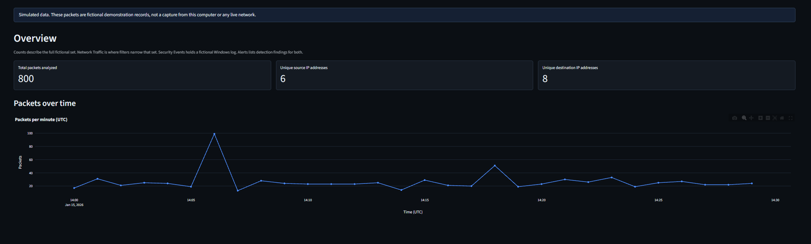
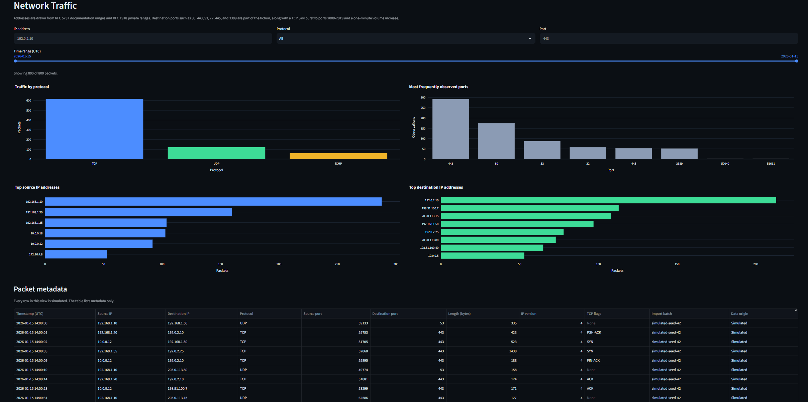
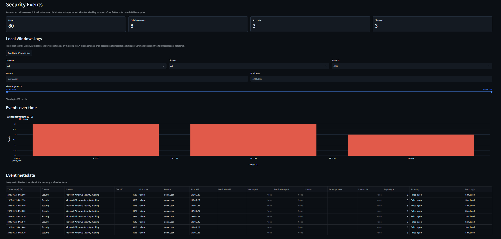
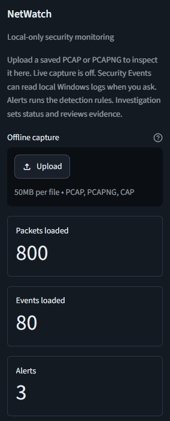

# NetWatch

NetWatch is a Python-based network security monitoring project designed to analyze packet metadata and Windows security events through a local Streamlit dashboard. It combines simulated security telemetry, offline packet capture analysis, and SQLite persistence to support structured exploration of network and system activity.

The project is being developed incrementally, with future phases introducing rule-based threat detection and investigation workflows.

Built to demonstrate a local security monitoring workflow—packets plus Windows events—using Streamlit and related tooling without live capture or a lab network, and to show disciplined scoping from simulation through offline analysis and persistence before detection.

## Stack

- **Language / runtime:** Python 3.12 on Windows 10 or later
- **UI:** Streamlit (dark theme, loopback bind) and Plotly charts
- **Data:** pandas; SQLite for the active packet and event sets
- **Packets:** Scapy for offline PCAP / PCAPNG metadata
- **Windows logs:** PowerShell and read-only `wevtutil` queries
- **Tests:** pytest

## Current status

Implemented now:

- **Phase 1 — Simulated traffic dashboard.** Seeded fictional packet metadata (800 rows, fixed 30-minute UTC window); Overview metrics and packets-over-time; protocol, top address, and port charts; filters for IP, protocol, port, and time; metadata table with a data-origin label
- **Phase 2 — Offline PCAP analysis.** PCAP / PCAPNG / CAP upload parsed with Scapy into that same table; 50 MB upload cap and 100,000 packet cap
- **Phase 3 — Windows events and SQLite.** Seeded fictional security events (80 rows, same window, including eight failed logons); Security Events page with filters and an events-over-time chart; optional local read of Security, System, Application, and Sysmon (missing channels and access denials reported and skipped); SQLite persistence for the active packet and event sets (`data/netwatch.db`); unit tests for the generator, record contracts, filters, capture parser, event reader, and database

Not implemented yet:

- **Phase 4 — Detection rules and alerts.** Failed authentication, possible port scanning, volume change, and user-defined watch rules
- **Phase 5 — Investigation and portfolio polish.** Alert status, evidence review, architecture notes, and additional investigation-scenario screenshots

## Screenshots

Views from Phases 1–3 on the seeded fictional packet and event sets. Save PNGs under [`docs/screenshots/`](docs/screenshots/) using the filenames below. Phase 5 will add further shots for the investigation workflow.









| File | Subject |
| --- | --- |
| `overview.png` | Overview metrics and packets-over-time |
| `network-traffic.png` | Network Traffic filters and table |
| `security-events.png` | Security Events, including failed logons for `demo.user` from `192.0.2.25` |
| `sidebar-pcap.png` | Sidebar offline capture upload (optional) |

## Limitations

NetWatch is a portfolio and learning project, not a production IDS. Scope stays on this machine and on metadata already in hand.

- No live packet capture; offline PCAP / PCAPNG upload only
- No payload bytes, command lines, free-text log messages, passwords, or threat-intelligence lookups
- No telemetry; data is not sent off the machine
- Dashboard binds to `127.0.0.1` only; do not expose it to the internet
- One active packet set and one active event set at a time
- Upload capped at 50 MB; at most 100,000 acceptable packets kept
- Local Windows log read needs appropriate rights; missing channels (for example Sysmon) are skipped

## Simulated data

Every packet in the demonstration set is generated in memory with a fixed random seed. Addresses come from [RFC 5737](https://www.rfc-editor.org/rfc/rfc5737) documentation ranges and [RFC 1918](https://www.rfc-editor.org/rfc/rfc1918) private ranges. While that set is loaded, the dashboard banner states that the rows are fictional.

## Offline captures

The sidebar accepts one `.pcap`, `.pcapng`, or `.cap` file. Parsing happens in memory. The capture is not written into the repository.

Scapy keeps timestamp, addresses, protocol, ports, length, IP version, and TCP flags. Packets without usable IP metadata are counted and skipped. Reading a saved file does not require Npcap.

The table column "Data origin" reads "Imported" for these rows. "Use simulated data" loads the fictional set again. Imported metadata is saved in the local database and shown again on the next launch.

## Windows events

Security Events opens on a seeded fictional log. The accounts are `demo.user`, `svc.backup`, and `lab.admin`. Addresses stay inside the same documentation and private ranges as the packets. Eight rows are failed logons for `demo.user` from `192.0.2.25`. While that set is loaded, the banner says the rows are fictional.

"Read local Windows logs" queries four channels with `wevtutil`: Security, System, Application, and Sysmon (`Microsoft-Windows-Sysmon/Operational`). The query is read-only; NetWatch does not clear logs. Refused or missing channels are reported and skipped. A read that keeps nothing leaves the current event set in place. The Security channel often refuses readers that are not elevated. Sysmon is absent unless it is installed.

For events it keeps, NetWatch stores time, channel, provider, event id, account, addresses, ports, the process file name, the parent file name, process id, logon type, and a fixed summary sentence such as "Failed logon." "Use simulated events" loads the fictional set again.

## Local database

The active packet set and the active event set are stored in `data/netwatch.db`. That file is gitignored. Restarting the dashboard loads it. An upload, a local log read, or a return to simulated data replaces the rows it owns.

Tests set `NETWATCH_DB` to a temporary file so they do not use the dashboard database.

## Requirements

- Windows 10 or later
- Python 3.12
- PowerShell

On this machine, `python` is the Microsoft Store alias and does not run Python 3.12. Use `py -3.12` to create the virtual environment, then the environment's `python.exe`.

## Setup

Run these commands in PowerShell from the repository root:

```powershell
py -3.12 -m venv .venv
.\.venv\Scripts\python.exe -m pip install -r requirements.txt
```

If activation is blocked by execution policy, you do not need to change that policy. Call `.\.venv\Scripts\python.exe` directly, as the commands above do.

## Run

PowerShell, from the repository root:

```powershell
.\.venv\Scripts\python.exe -m streamlit run app.py --server.address 127.0.0.1 --server.port 8501
```

Open http://127.0.0.1:8501 in a browser on this computer.

## Test

PowerShell, from the repository root:

```powershell
.\.venv\Scripts\python.exe -m pytest
```

Generator, filter, parser, event, and database tests call those functions directly. They build small captures in memory and do not send packets. They do not query this computer's Windows logs; the reader tests pass in XML and canned status text. Dashboard tests set `NETWATCH_DB` to a temporary file. One test runs the dashboard through Streamlit's app runner to confirm an upload replaces the fictional packet set and a file that is not a capture leaves that set in place. Another confirms Security Events can switch to a canned local read and back to the fictional log.

In the dashboard, Overview shows the full seeded set. On Network Traffic:

- IP `192.0.2.10` narrows the table to packets involving that documentation address.
- IP `192.0.2.199` is valid and outside the seeded set, so the table is empty.
- Protocol, port, and the UTC time slider narrow the same table.

On Security Events, the fictional set includes failed logons for `192.0.2.25`. Outcome, channel, event id, account, IP, and the UTC time slider narrow that table. "Read local Windows logs" reports each channel. Access denied, or a missing Sysmon channel, leaves the fictional set in place when nothing was kept.

## Inspect a saved capture

Start the dashboard, then use "Offline capture" in the sidebar. After a successful import, Overview and Network Traffic describe that file. "Use simulated data" loads the 800-row demonstration set again.

A file that is not a PCAP or PCAPNG leaves the current packet table in place and shows an error in the sidebar.

## Architecture

Packet metadata and Windows events both land in the local SQLite store. The Streamlit dashboard reads that store.

```text
                   NETWATCH
                      |
              DATA COLLECTION
                      |
          -------------------------
          |                       |
     Packet Sources          Event Sources
          |                       |
    -------------           -------------
    |           |           |           |
 Simulated    Offline    Simulated    Windows
  Packets      PCAP       Events       Logs
                |                       |
              Scapy                   wevtutil
    |           |           |           |
    -------------           -------------
          |                       |
          v                       v
     Packet Dataset          Event Dataset
          |                       |
          ----------- -------------
                      |
                      v
                 SQLite DB
                      |
                      v
              Streamlit Dashboard
                      |
        -----------------------------
        |             |             |
     Overview   Network Traffic  Security Events
```

## Project layout

```text
NetWatch/
├── app.py                     # Streamlit entry point and localhost navigation
├── core/
│   ├── models.py              # Packet, event, rule, and alert records
│   ├── sample_data.py         # Seeded fictional traffic
│   ├── packet_analyzer.py     # Offline PCAP and PCAPNG metadata
│   ├── log_analyzer.py        # Fictional events and read-only Windows logs
│   ├── database.py            # Local SQLite store
│   └── filters.py             # Filter and summary functions
├── dashboard/
│   ├── common.py              # Banner, chart styling, table formatting
│   ├── state.py               # Session state and database loads
│   ├── overview.py            # Metrics and packets over time
│   ├── network.py             # Charts, filters, and the packet table
│   └── security_events.py     # Event filters, chart, and local log read
├── data/                      # Local database and captures (gitignored)
├── docs/screenshots/          # Dashboard PNGs linked from this README
├── tests/
├── .streamlit/config.toml     # Loopback bind, dark theme, upload cap
├── requirements.txt
├── LICENSE
└── README.md
```

Upcoming modules, not present until their phase: `core/detection_engine.py`, `dashboard/alerts.py`, and `dashboard/investigation.py`.

## Roadmap

1. **Simulated traffic dashboard.** Done.
2. **Offline PCAP analysis.** Done. Upload a saved capture and parse metadata with Scapy. Live capture stays off.
3. **Windows events and SQLite.** Done. Fictional security events, an optional local log reader that handles missing channels and access denied, and a local SQLite file for the active packet and event sets.
4. **Detection engine.** Failed authentication, possible port scanning, volume change, and user-defined watch rules. Alert text will describe behavior, not a confirmed attack.
5. **Investigation and portfolio polish.** Alert status, evidence review, architecture notes, and additional investigation-scenario screenshots.

## Technical findings and lessons learned

Concrete decisions from building Phases 1–3:

- **Metadata only.** Scapy parses uploads for addresses, ports, protocol, length, and flags. Payload bytes, command lines, and free-text log messages stay out of the models and the SQLite schema so the demo stays safer to share and closer to a monitoring UI than a full packet dump.
- **Streamlit CORS defaults.** In Streamlit 1.66, `server.enableCORS = false` allows every origin. NetWatch leaves CORS protection on, binds to `127.0.0.1`, and limits `allowedHosts` to localhost addresses.
- **Windows log access is uneven.** `wevtutil` is read-only here, but the Security channel often denies non-elevated readers and Sysmon may be absent. Reporting and skipping those channels is more honest than treating a partial read as a full local picture.
- **One active set per domain.** SQLite holds one packet set and one event set at a time. Upload, local log read, or a return to simulated data replaces that domain’s rows. Tests point `NETWATCH_DB` at a temporary file so they never touch the dashboard database.
- **Fictional ranges on purpose.** Seeded addresses use RFC 5737 documentation space and RFC 1918 private ranges, with a visible data-origin banner, so the demonstration set is not mistaken for a live capture from this machine.

## License

MIT. See [LICENSE](LICENSE).
